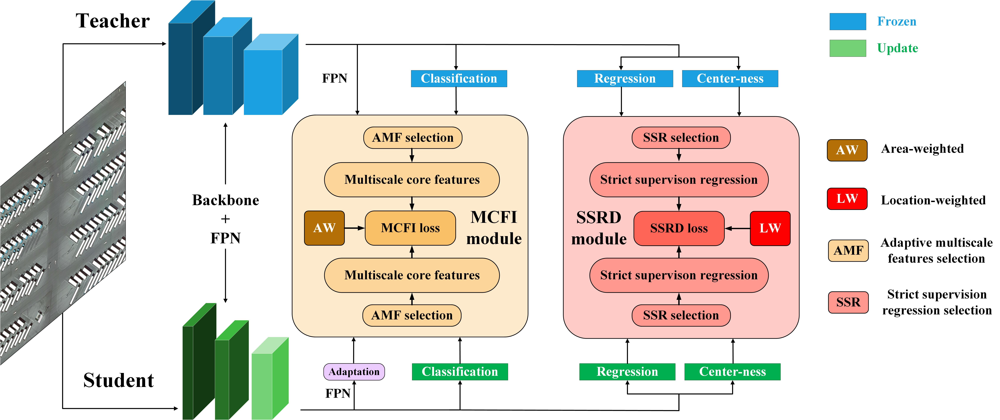
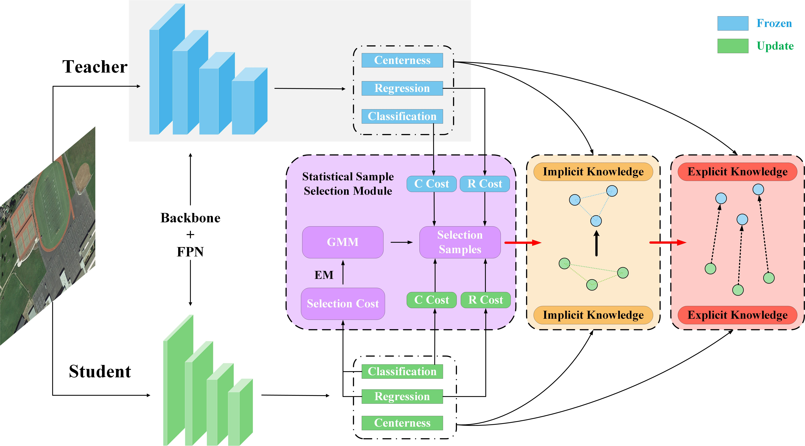
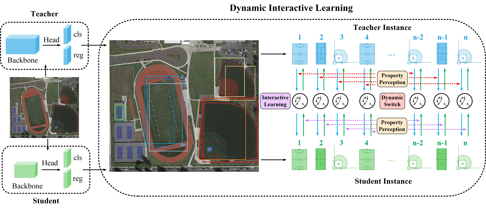

# Remote-Sensing-Distillation

基于 **mmdetection v2.3.0rc0** 的遥感目标检测与知识蒸馏研究代码库，支撑三篇论文（ARSD / S3MKM / DIL），在 **DOTA、DIOR、NWPU VHR-10** 三个遥感数据集上开展教师-学生蒸馏实验。

| 论文   | 方法  | 蒸馏检测器                                                            | 检测头                      | 配置目录                   |
| ------ | ----- | --------------------------------------------------------------------- | --------------------------- | -------------------------- |
| paper1 | ARSD  | `Distill_Atss`（`distill_atss.py`，基础版 `distill_retina.py`） | `ATSSHeadnew`（面积加权） | `a_config/paper1_ARSD/`  |
| paper2 | S3MKM | `Dis_ATSS` / `Distill_PAA`（`dis_atss.py` / `dis_paa.py`）    | `ATSSHead2`               | `a_config/paper2_S3MKM/` |
| paper4 | DIL   | `DIL_ATSS`（`DIL_atss.py`，支持 student2 双学生互学）             | `ATSSHeadDIL`             | `a_config/paper4_DIL/`   |

蒸馏范式：ATSS 教师（R101，NWPU 用 R50）→ 轻量学生（R18 / MobileNetV2 / ShuffleNet / RegNet，FPN 与 backbone 通道可减半/减至 1/4）。

> 本 README 以当前代码实际状态为准，融合了根目录三份历史说明（`代码说明.txt`、`基本说明.txt`、`说明dota.txt`），并修正了其中过时的路径与文件名。上游 mmdetection 原版 README 保留为 [README_mmdet.md](README_mmdet.md)。

## 目录结构

```
Remote-Sensing-Distillation/
├── mmdet/                  核心库（含自定义模块，见下文）
│   └── yyr_creation/       自研工具：逐类别 mAP 的 pycocotools、多色可视化
├── a_config/               全部自定义配置（237 个），详见 a_config/README.md
├── configs/                mmdetection 上游原版配置
├── tools/                  训练/测试/分析脚本（含自加的 parse_result*.py）
├── DOTA_devkit/            DOTA 数据准备 + 结果拼接（被 tools 导入，改造版）
├── DOTA_devkit-master/     DOTA 原图评测脚本 + GPU 多边形 NMS（原版+自加脚本）
├── yyr_others/             工具笔记与脚本（anchor 统计、均值方差、曲线绘制等）
├── docs/  tests/  demo/    上游文档/测试/示例
└── 代码说明.txt / 基本说明.txt / 说明dota.txt   历史说明（服务器环境原始记录）
```

## 环境安装

官方 README 的 Install 指引（[youngfly/Remote-Sensing-Distillation](https://github.com/youngfly/Remote-Sensing-Distillation/blob/master/README.md)）共两条：

1. 按 mmdetection 官方安装说明配置环境：https://github.com/open-mmlab/mmdetection （本项目基线为 v2.3.0rc0，参照其 2.x 早期文档，勿按最新 3.x 流程安装）
2. 若使用 DOTA 数据集，需安装 DOTA_devkit：https://github.com/CAPTAIN-WHU/DOTA_devkit （本仓库已内置两份改造/原版目录 `DOTA_devkit/` 与 `DOTA_devkit-master/`，无需另行下载，但需按下文编译）

结合本地代码核实的具体安装步骤如下。

老版本环境栈（与 mmdet 2.3 同期）：**Python 3.6 + PyTorch 1.5/1.6 + mmcv-full 1.0 系**。

安装依赖（会自动从 `mmdet/VERSION` 生成 `mmdet/version.py`，该文件缺失属正常）：

```bash
pip install -r requirements.txt
pip install -e .
```

DOTA 评测/拼接依赖 SWIG 编译的多边形 IoU 扩展，两个 devkit 目录各自编译（本仓库未携带编译产物，换机器必须重编）：

```bash
cd DOTA_devkit
swig -c++ -python polyiou.i
python setup.py build_ext --inplace
```

`DOTA_devkit-master` 同理；如需 GPU 版多边形 NMS，另编 `DOTA_devkit-master/poly_nms_gpu/`（需 nvcc）。

RegNet 预训练模型需先转换格式（注意：脚本实际位于 `tools/` 根下，历史说明中的 `tools/model_converters/` 路径已过时）：

```bash
python -u tools/regnet2mmdet.py ${PRETRAIN_PATH} ${STORE_PATH}
```

## 自定义模块（代码说明.txt 融合版）

### 数据集（mmdet/datasets/）

| 文件        | 继承            | 要点                                                                                                                                                     |
| ----------- | --------------- | -------------------------------------------------------------------------------------------------------------------------------------------------------- |
| `dota.py` | COCO 数据集     | 改为 DOTA 15 类                                                                                                                                          |
| `dior.py` | XML(VOC) 数据集 | 改为 DIOR 20 类；**年份必须改为 2020**，否则评测输出原 VOC 类别；重写了 `evaluate` 和 `get_ann_info`                                           |
| `nwpu.py` | COCO 数据集     | 改为 NWPU 10 类；重写 `evaluate`，通过 `from pycocotools.cocoeval1 import COCOeval` 调用自研逐类别 mAP（见 `mmdet/yyr_creation/pycocotools_yyr/`） |

新增数据集需在 `mmdet/datasets/__init__.py` 注册。

### 模型（mmdet/models/）

- **backbones**：`resnet_half.py`（通道减半）、`resnet_quarter.py`（通道 1/4）
- **dense_heads**：`atss_head_new.py`（paper1，面积加权 `exp(-sqrt(area)/512)+1`）、`atss_head2.py`（paper2）、`atss_head_DIL.py`（paper4）
- **detectors**：`distill_retina.py`（基础蒸馏）、`distill_atss.py`（paper1）、`dis_atss.py` / `dis_paa.py`（paper2）、`DIL_atss.py`（paper4）
- **losses**：`iou_loss.py` 新增 `niou_loss`，修复权重返回 0 的问题

新增模块均需在对应 `__init__.py` 注册（当前快照已全部注册）。

### 自研工具（mmdet/yyr_creation/）

- `pycocotools_yyr/`：COCO 评测逐类别 mAP 输出
- `visualization/`：修复原版单颜色绘图问题，多类别多色显示

## 配置系统

全部实验配置在 `a_config/`（注意是单数，历史说明中的 `a_configs/`、`b_configs/` 为服务器旧目录名）：

- `base_configs/`：三数据集基线池（ATSS/RetinaNet/FCOS/PAA/GFL 等 × R18/50/101/RegNet）
- `paper1_ARSD/`、`paper2_S3MKM/`、`paper4_DIL/`：各论文师生与蒸馏配置

命名规律、超参表、消融矩阵与已知配置问题详见 **[a_config/README.md](a_config/README.md)**。

三数据集统一超参：DIOR 800×800 / bs8 / 24ep / lr0.005；DOTA 1024×1024 / bs8 / 24–30ep / lr0.005；NWPU 1000×600 / bs4 / 40ep / lr0.001。

## 训练与测试（基本说明.txt 融合版）

所有配置中的 `data_root`、`pretrained`、`tea_pretrained` 原为服务器路径（`/home/airstudio/...`、`/workspace/...`），本机运行前必须改为自己路径；蒸馏实验需先训好教师。

单卡训练：

```bash
CUDA_VISIBLE_DEVICES=0 python tools/train.py a_config/paper1_ARSD/dota/distill/distill_atss_101_18_f0.5_dota_area.py
```

多卡分布式训练：

```bash
CUDA_VISIBLE_DEVICES=0,1 PORT=29500 tools/dist_train.sh <config.py> 2
```

VOC 格式数据集（DIOR）测试，评测指标 mAP：

```bash
python tools/test.py <config.py> <checkpoint.pth> --eval mAP
```

COCO 格式数据集（DOTA/NWPU）测试，评测指标 bbox：

```bash
python tools/test.py <config.py> <checkpoint.pth> --eval bbox
```

DOTA 测试同时导出 pkl 供大图拼接（见下节）：

```bash
python tools/test.py <config.py> <checkpoint.pth> --eval bbox --out result.pkl
```

注意：测试前确认 config 的 `test_cfg`/data.test 指向正确的验证集或测试集。

## DOTA 大图评测完整流程（说明dota.txt 融合版）

两个 devkit 目录分工不同，缺一不可：`DOTA_devkit/` 负责①裁剪和③拼接（import 已改造为包形式，被 tools 硬依赖）；`DOTA_devkit-master/` 负责④评测（评测脚本仅存于此）。

**第 1 步：裁剪大图并生成 COCO 标注**（`DOTA_devkit/dota_pre.md` 有详细教程）

```bash
python DOTA_devkit/prepare_dota1.py --srcpath path_to_dota --dstpath path_to_split_1024
```

**第 2 步：训练 / 测试，导出 pkl**（命令见上节；验证集与测试集分别走 `parse_result.py` / `parse_result_test.py`）

**第 3 步：pkl → txt，拼接回大图尺度**

```bash
python tools/parse_result.py
```

运行前修改 `tools/parse_result.py` 的 `__main__` 入口内硬编码项：`pkl_file`（第 2 步输出）、`output_path`、`load_annotations(...)` 的 json 路径（验证集或测试集标注）。输出两个目录：`Task2_results/` 与 `Task2_results_nms/`（历史说明写作小写 task2，实际代码为大写 Task2），下一步用 **Task2_results_nms**。

**第 3.5 步：生成原图名单 txt**

```bash
python DOTA_devkit-master/name_birth.py
```

运行前修改脚本第 2 行的 labelTxt 目录（原值硬编码 `/workspace/dota_ori/DOTA_raw/val/labelTxt/`），输出 `val.txt`。

**第 4 步：原图尺度评测**

```bash
python DOTA_devkit-master/dota_evaluation_task2.py
```

运行前修改文件末尾 main 中三个路径：`detpath`（Task2_results_nms 目录）、`annopath`（DOTA 原图标签模板）、`imagesetfile`（第 3.5 步的名单 txt）。

在测试集上评测时，将上述验证集相关输入替换为测试集对应文件（历史做法：把 config 测试集内容替换为验证集跑一遍再换回，注意改回）。

## 分析工具（基本说明.txt 融合版）

参数量 / FLOPs（输入尺寸在脚本内设置）：

```bash
python tools/get_flops.py a_config/base_configs/nwpu/resnet/retinanet_r50_fpn_1x_nwpu.py
```

检测结果可视化（对测试集全部图片绘制检测框，多色显示依赖 yyr_creation/visualization；可能需同步修改 mmcv 安装目录内的对应文件）：

```bash
python tools/test.py <config.py> <checkpoint.pth> --show-dir vis_result/<name>
```

训练曲线绘制（普通损失 / 蒸馏损失 / 与基线对比，键名按日志实际字段调整）：

```bash
python tools/analyze_logs.py plot_curve <run.log.json> --keys loss_cls loss_bbox loss_centerness --legend loss_cls loss_reg loss_centerness --out loss.pdf
python tools/analyze_logs.py plot_curve <run.log.json> --keys loss_sup_fpn loss_sup_cls loss_sup_reg --legend loss_sup_fpn loss_sup_cls loss_sup_reg --out loss_sup.pdf
python tools/analyze_logs.py plot_curve <distill.log.json> <baseline.log.json> --keys bbox_mAP_50 --legend with_distillation baseline --out mAP50_compare.pdf
```

更多小工具（anchor 面积/长宽比统计、数据集均值方差、训练测试笔记）见 `yyr_others/`。

## 已知问题与复现注意

**复现注意**：

1. **代码硬编码**：`distill_atss.py:39` 以 `self.imitation_loss_weight = 0.01` 覆盖配置值，配置中写其他权重无效；`dis_atss.py` 蒸馏开关虽已全 True，但仍为代码内硬编码，消融切换需改代码而非改配置。另 `dis_paa.py` 仅 `if_cat=True`、其余开关为 False，复现 paper2 前需确认是否有意为之。
2. **数据集规模硬编码**：`dis_atss.py:111` `self.images` 固定取 DOTA 训练集大小 15749（dior/voc/nwpu 的数值已定义但未启用），DIOR/NWPU 上延迟蒸馏轮数计算错误。
3. **自研类未实现**：`SS`、`SSHead`、`SS_BAYHead`、`PAAQFLHead`、`CIoULoss`、`DIoULoss` 未注册（`baseline_self_statistics` / `baseline_regnet_compose` 目录的配置引用了它们），这些配置可加载但无法构建模型。
4. **路径失效**：204 个配置的 pretrained / tea_pretrained / data_root 为 `/home/airstudio/...`、`/workspace/...` 服务器路径，本机不存在，需逐一替换；部分路径含空格及 `pretained` 拼写错误。
5. **devkit 未编译**：polyiou 扩展需在目标机器重新 SWIG 编译（见环境安装节）。
6. **名实/参数不一致**（影响结果可比性）：`paper1_ARSD/other/.../student_on_gn` 目录内 head 实际 `norm_cfg=None`，与目录名含义相反；个别 DOTA 基线训练 Resize 800×800 而测试 1024×1024；paper4 dior 各 backbone lr 不一致（Res 0.01 / Shu 0.001），paper2 dota Res 的 1dsn=30ep 与 2dsn=24ep 不一致。
7. 历史说明中的命令使用旧目录名（`a_configs/`）与旧脚本路径（`tools/model_converters/`），本 README 已按现状修正。

完整清单与修复记录见 [a_config/README.md](a_config/README.md) 的"已知问题"节。

## Paper

本项目对应三篇 IEEE TGRS 论文（官方仓库：[youngfly/Remote-Sensing-Distillation](https://github.com/youngfly/Remote-Sensing-Distillation)）：

**1. ARSD**（本地 `a_config/paper1_ARSD/`）
Adaptive Knowledge Distillation for Lightweight Remote Sensing Object Detectors Optimizing
IEEE Transactions on Geoscience and Remote Sensing, vol. 60, pp. 1-15, 2022.
Link: https://ieeexplore.ieee.org/document/9775159/



**2. S3MKM**（本地 `a_config/paper2_S3MKM/`）
Statistical Sample Selection and Multivariate Knowledge Mining for Lightweight Detectors in Remote Sensing Imagery
IEEE Transactions on Geoscience and Remote Sensing, vol. 60, pp. 1-14, 2022.
Link: https://ieeexplore.ieee.org/document/9832637/



**3. DIL**（本地 `a_config/paper4_DIL/`）
Dynamic Interactive Learning for Lightweight Detectors in Remote Sensing Imagery
IEEE Transactions on Geoscience and Remote Sensing, vol. 60, pp. 1-14, 2022.
Link: https://ieeexplore.ieee.org/document/9921272/



注：官方 README 将 DIL 编号为 3，本地目录沿用内部编号 paper4；`代码说明.txt` 中的 "S2MKM" 为笔误，正式方法名为 S3MKM（官方配图文件名仍作 s2mkm）。

## Citation

If our work is useful or relevant to your research, please kindly recognize our contributions by citing our papers:

```bibtex
@article{yang2022adaptive,
	title={Adaptive Knowledge Distillation for Lightweight Remote Sensing Object Detectors Optimizing},
	author={Yang, Yiran and Sun, Xian and Diao, Wenhui and Li, Hao and Wu, Youming and Li, Xinming and Fu, Kun},
	journal={IEEE Transactions on Geoscience and Remote Sensing},
	year={2022},
	volume={60},
	number={},
	pages={1-15},
	publisher={IEEE}
}

@article{yang2022statistical,
	title={Statistical Sample Selection and Multivariate Knowledge Mining for Lightweight Detectors in Remote Sensing Imagery},
	author={Yang, Yiran and Sun, Xian and Diao, Wenhui and Yin, Dongshuo and Yang, Zhujun and Li, Xinming},
	journal={IEEE Transactions on Geoscience and Remote Sensing},
	volume={60},
	pages={1--14},
	year={2022},
	publisher={IEEE}
}

@article{yang2022dynamic,
	title={Dynamic Interactive Learning for Lightweight Detectors in Remote Sensing Imagery},
	author={Yang, Yiran and Diao, Wenhui and Rong, Xuee and Li, Xinming and Sun, Xian},
	journal={IEEE Transactions on Geoscience and Remote Sensing},
	volume={60},
	pages={1--14},
	year={2022},
	publisher={IEEE}
}
```

## 历史文档索引

| 文件                        | 内容                                    | 时效性                                         |
| --------------------------- | --------------------------------------- | ---------------------------------------------- |
| `代码说明.txt`            | 自定义模块清单与注册位置、论文-目录对应 | 模块清单与现状一致；paper3_DIL 实为 paper4_DIL |
| `基本说明.txt`            | 训练/测试/参数量/可视化/曲线命令        | 命令有效，路径需按本 README 修正               |
| `说明dota.txt`            | DOTA 四步评测流程与 devkit 编译         | 流程有效；行号/大小写细节以本 README 为准      |
| `README_mmdet.md`         | 上游 mmdetection 原版 README            | 仅供参考                                       |
| `DOTA_devkit/dota_pre.md` | DOTA 数据准备教程                       | 有效                                           |
